<div align="center">

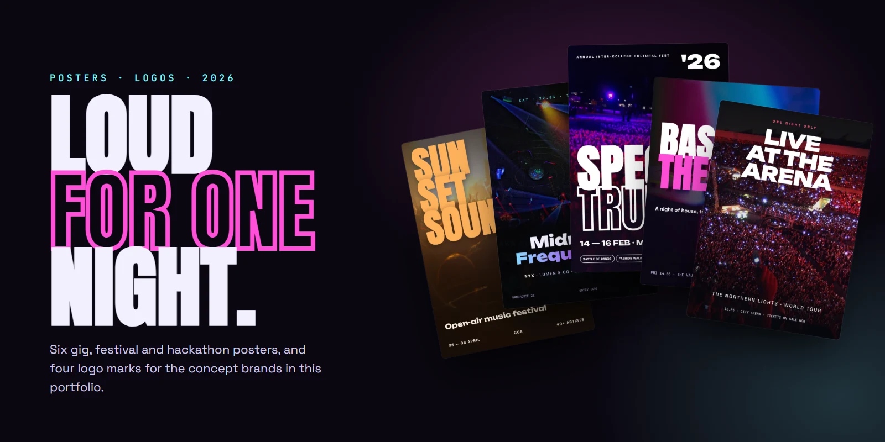

<br>

# Posters & Logos

**Six event posters and four logo marks.**
Gigs, festivals, a club night and a 24-hour hackathon, plus identities for every concept brand in my portfolio.


[**See them live on my portfolio →**](https://guru1315-portfolio.vercel.app/graphic-designer)

</div>

---

## The posters

A poster has about two seconds on a wall or a feed. Every poster here is built to win those two seconds: **one huge piece of type, one photo with real atmosphere, and the date, place and price where your eye lands next.** Each event gets its own type voice, so no two look alike.

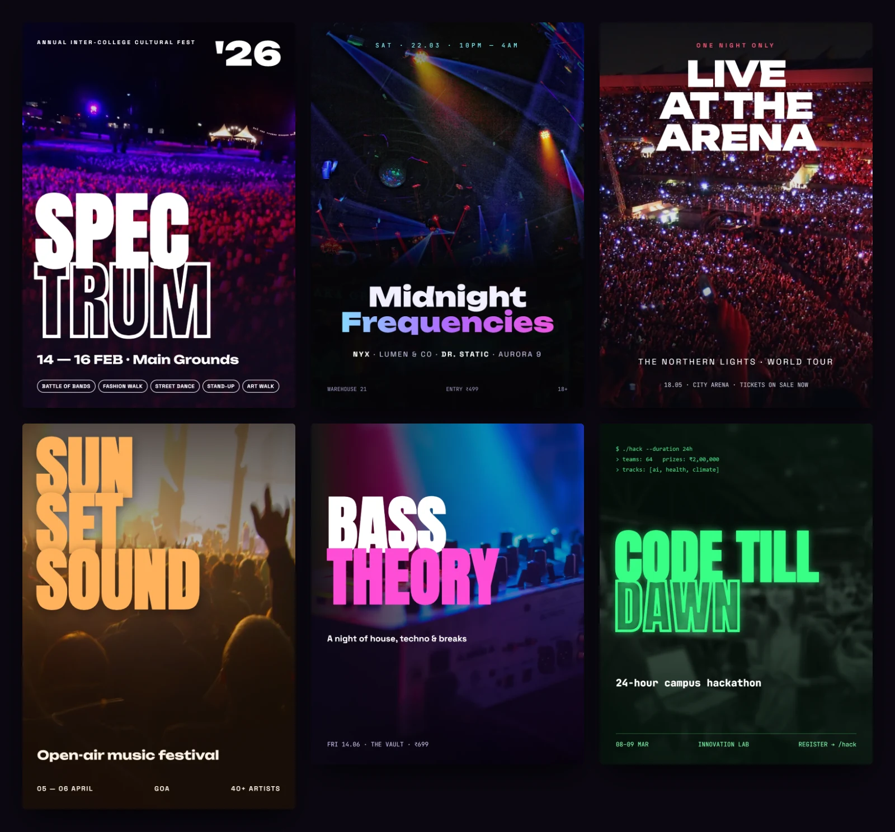

| # | Poster | Event | The type idea |
|:-:|---|---|---|
| 01 | **Spectrum '26** | Inter-college cultural fest, 3 days | Condensed *Anton* split into solid SPEC and outlined TRUM, over a sea of festival lights |
| 02 | **Midnight Frequencies** | Club night, 10 pm–4 am | *Unbounded* with a cyan-violet-pink gradient that sounds like a synth |
| 03 | **Live at the Arena** | One-night stadium show | Stacked, centred *Unbounded* over a sea of phone lights |
| 04 | **Sun Set Sound** | Open-air music festival, Goa | Three warm, stacked words in sunset orange over a golden-hour crowd |
| 05 | **Bass Theory** | House, techno & breaks night | White and hot-pink *Anton* cutting across a mixing desk |
| 06 | **Code Till Dawn** | 24-hour campus hackathon | Terminal-green glowing type, a `$ ./hack` prompt and a terminal cursor block |

<details>
<summary><b>View every poster full size</b></summary>
<br>

<p align="center">
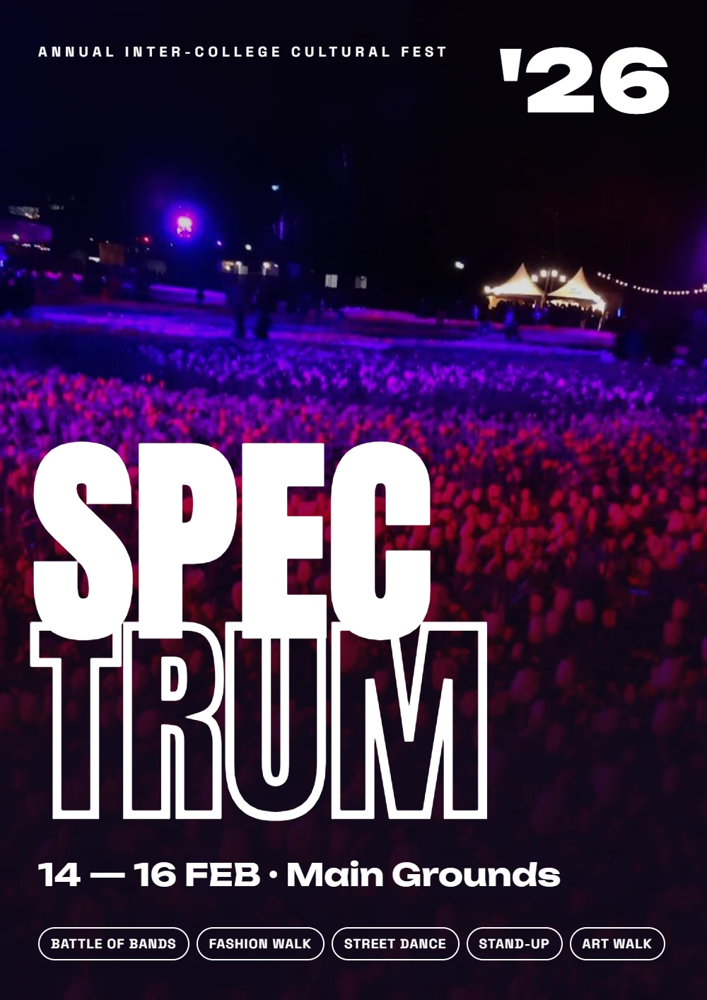
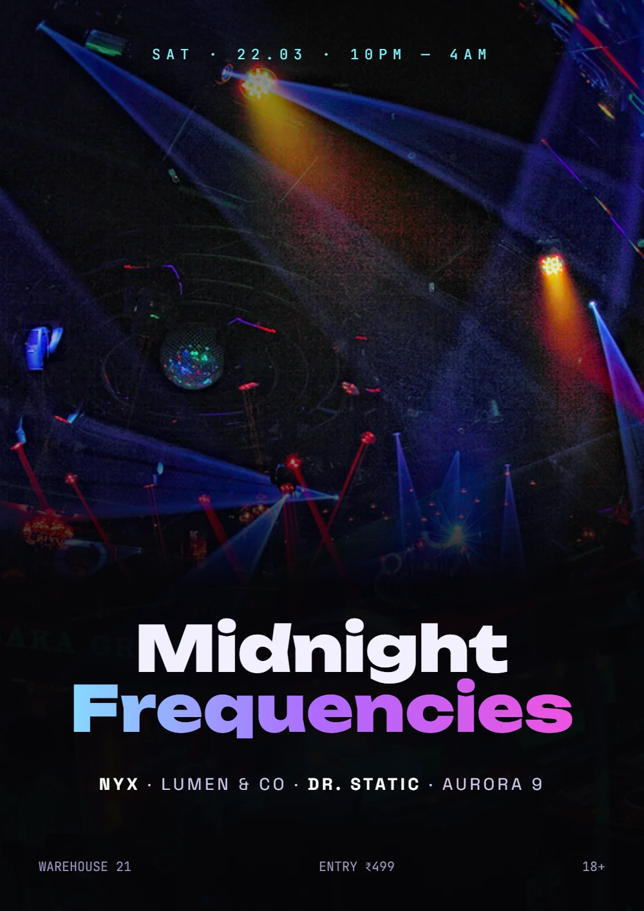
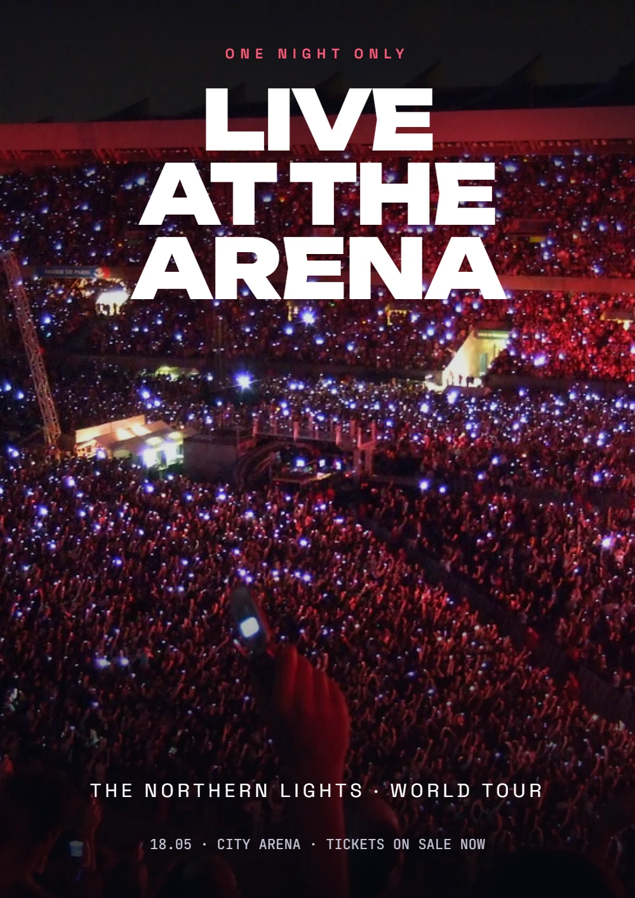
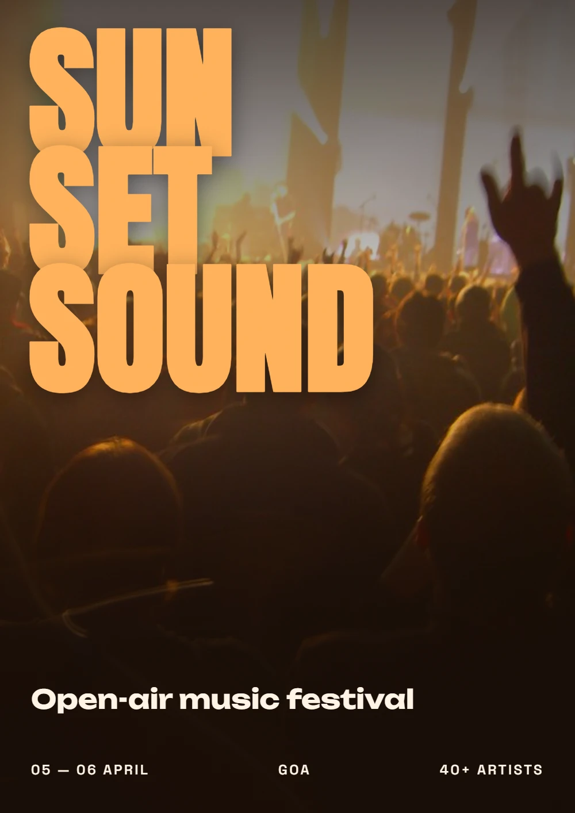
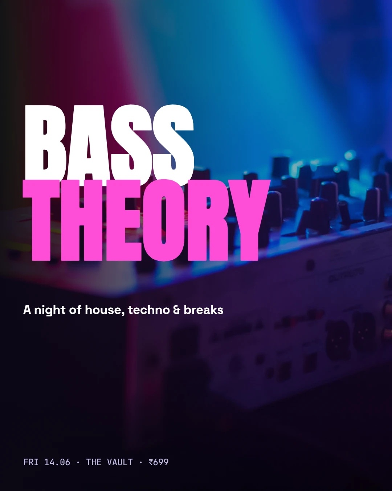
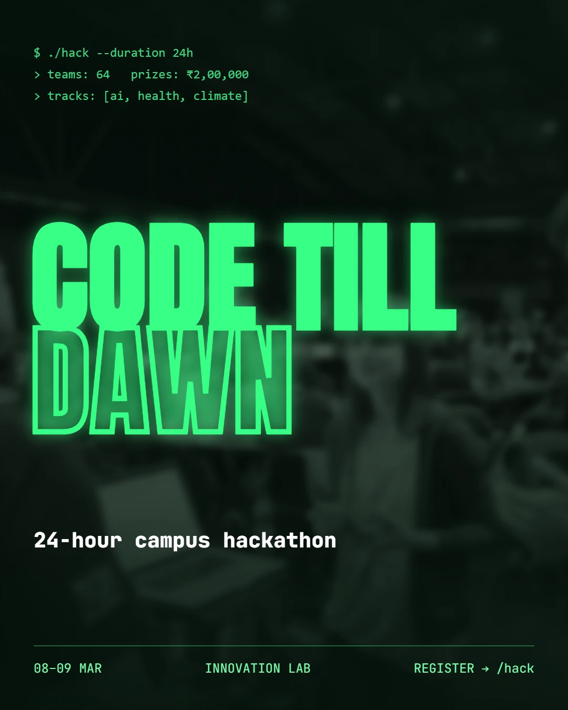
</p>

</details>

### Poster rules

1. **Title first.** The event name takes at least a third of the poster.
2. **Then when, where and how much,** always on one line near the bottom.
3. **The photo sets the mood, never the message.** It's darkened, tinted or blurred until the type wins.
4. **One accent colour per poster:** pink, cyan, lime, orange or green, never two fighting.

## The logos

Each mark is built from one idea about its brand, and each comes as a clean vector SVG plus a presentation on the brand's own photography.

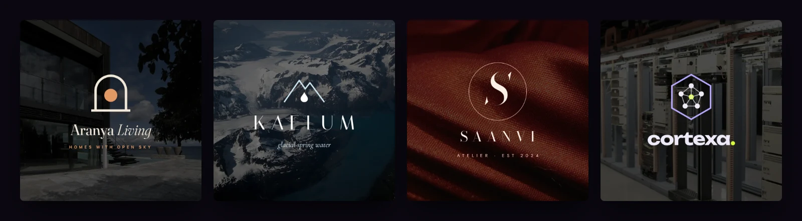

<table>
<tr>
<td width="50%" align="center">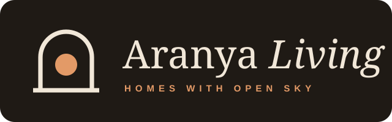</td>
<td width="50%" align="center">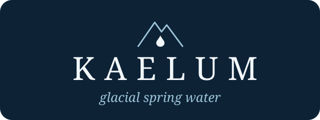</td>
</tr>
<tr>
<td><b>Aranya Living</b>: real estate. An arched window with the sun inside it, so light and home are one shape. <i>Fraunces + Manrope.</i></td>
<td><b>Kaelum Springs</b>: glacial water. A mountain ridge with one falling drop, so the source and the product are one line. <i>Italiana + Cormorant.</i></td>
</tr>
<tr>
<td width="50%" align="center">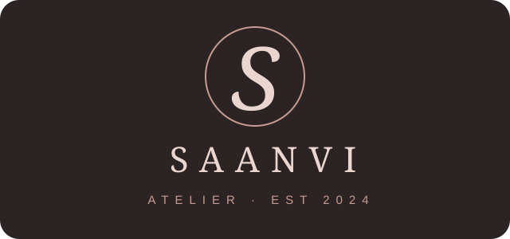</td>
<td width="50%" align="center">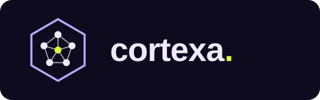</td>
</tr>
<tr>
<td><b>Saanvi Atelier</b>: handloom fashion. An italic Bodoni <i>S</i> in a hairline circle, like a stitched garment label. <i>Bodoni Moda + Jost.</i></td>
<td><b>Cortexa AI</b>: crowd-safety AI. A hexagon holding a neural network, with the centre node lit in lime. <i>Unbounded.</i></td>
</tr>
</table>

Each brand has its own full campaign repo: **[Aranya Living](https://github.com/Guru1315/Aaranya-Living)** · **[Kaelum Springs](https://github.com/Guru1315/kaelum-springs)** · **[Saanvi Atelier](https://github.com/Guru1315/Saanvi-Atelier)** · **[Cortexa AI](https://github.com/Guru1315/Cortexa-AI)**

## Repository

```
Posters-logos/
├── posters/             6 posters (WebP)
├── logos/
│   ├── svg/             4 vector logos
│   └── on-photo/        4 logo presentations on photography
├── assets/              README banner, poster wall and logo sheet
└── CREDITS.md           photographers and licences
```

<div align="center">
<br>

**[Portfolio](https://guru1315-portfolio.vercel.app)** · **[More graphic design work](https://guru1315-portfolio.vercel.app/graphic-designer)**

</div>
